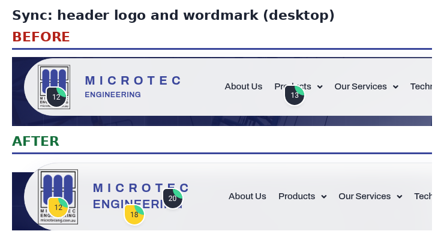
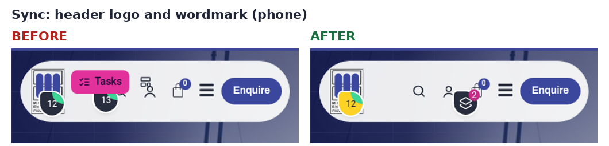
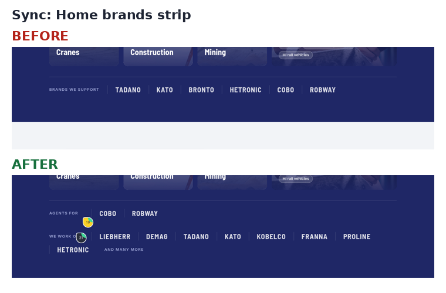

# Sync report: live site → repo (9 Nov 2026)

The live site (microteceng.wsdfy.com) was the source of truth. Everything was **read** from it: theme files staged and downloaded, page content read through Elementor, screenshots taken. **Nothing on the live site was written, saved, published or changed.**

## What was compared

| Area | Live vs repo before sync | Action in repo |
|---|---|---|
| Theme `assets/css/microtec.css` | **Different** (changed on the live site) | Replaced with the live file |
| Theme `style.css` | Only on live (theme header) | Added |
| Theme `mt-search-debug.php`, `mt-search-debug2.php` | Only on live (empty stubs, "safe to delete") | Added, so the repo mirrors the live theme |
| The other 16 theme files (functions.php, mt-shop.css, mt-pages.css, JS, search.php, category intros…) | Identical | None |
| Home page (Elementor, post 48, modified on the live site 6 Nov) | 3 of 8 widgets differ | `sections/home.elementor.json` updated |
| Header, footer, menus, products, other pages | Not modified on the live site since our last session (footer 28 Oct, header 20 Oct, products 26 Oct, menus 28/30 items as left) | None |

After the sync, `diff -r` of the repo `theme/` folder against the 20 live theme files reports **no differences**.

## Changes made on the live site from the other account

### 1. Header logo and wordmark (`microtec.css`)
- Logo height 74px → **92px**.
- ENGINEERING line: 12.5px → **20px**, the same size as MICROTEC (comment #18), letter spacing .2em → .01em.
- Phones: ENGINEERING is now shown at 14px (it was hidden before).
- Home page header overlap adjusted: -98px → **-116px** to fit the taller bar.

```diff
@@ -152,7 +152,7 @@
 
 /* ---------- Header (UAE) ---------- */
 
-.mt-logo img { height: 74px !important; width: auto !important; max-width: none; display: block; }
+.mt-logo img { height: 92px !important; width: auto !important; max-width: none; display: block; }
 .mt-logo .hfe-site-logo-container { display: block; line-height: 0; }
 
 /* Wordmark beside the logo mark: the name baked into the logo PNG is 85px wide at
@@ -175,11 +175,13 @@
 	text-transform: uppercase;
 	color: var(--mt-blue);
 }
-.mt-wordmark__b {
+/* Client asked for ENGINEERING at the same size as MICROTEC (03 Nov 2026). Scoped to the
+   header lockup (an <a>) so the footer wordmark keeps the rules further down this file. */
+a.mt-wordmark .mt-wordmark__b {
 	font-family: "Archivo", sans-serif;
 	font-weight: 600;
-	font-size: 12.5px;
-	letter-spacing: .2em;
+	font-size: 20px;
+	letter-spacing: .01em;
 	text-transform: uppercase;
 	color: var(--mt-blue);
 	margin-top: 4px;
@@ -187,7 +189,7 @@
 /* Phones: one line, then the mark alone. The icons and Enquire need the room. */
 @media (max-width: 767px) {
 	.mt-wordmark__a { font-size: 14px; letter-spacing: .06em; }
-	.mt-wordmark__b { display: none; }
+	a.mt-wordmark .mt-wordmark__b { font-size: 14px; letter-spacing: .02em; }
 }
 @media (max-width: 599px) {
 	.elementor-widget.mt-wordmark-w { display: none !important; }
@@ -255,7 +257,7 @@
 	box-shadow: 0 10px 30px rgba(59, 71, 156, .10);
 }
 /* On the homepage the floating bar sits over the hero */
-body.home #masthead { margin-bottom: -98px; }
+body.home #masthead { margin-bottom: -116px; }
 
 .mt-header-icon .elementor-icon,
 .mt-header-bar .hfe-search-button-wrapper .hfe-search-icon-toggle,
```




### 2. Home brands strip (widget `b2183f3`)
- "Brands we support: Tadano · Kato · Bronto · Hetronic · Cobo · Robway" →
  - **Agents for:** Cobo · Robway (comment #19)
  - **We work on:** Liebherr · Demag · Tadano · Kato · Kobelco · Franna · Proline · Hetronic **and many more** (comment #21)



## Repo copy brought up to date with earlier live edits (28 Oct)
These were already live but the repo's `home.elementor.json` hadn't been updated:
- Widget `6dbfdd9`: "Design · Repairs · Installation · Technical Support".
- Widget `51cafb1`: Popular Parts 4th card → Robway parts and systems (Robway LCD tile photo, link /brand/robway/).
